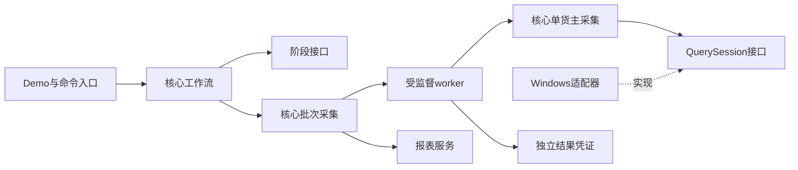

# 原生采集的职责与执行边界

2026-10-13，基线为用户运行包（14），本地恢复点61819e08。当前工作流为one-click-steps-v7.5-network-login-wait；发布源码版本以SOURCE_MANIFEST.json为准。2026-10-14六项复核修改与验证见[复核记录](review_followup_20261014.md)。

## 职责划分

| 模块 | 职责 |
| --- | --- |
| core/collection_contracts.py | 不可变任务、阶段请求、固定日期和worker身份 |
| core/query_policy.py | 准备、等待、查询、采样和外层监督预算 |
| core/native_workflow.py | 阶段衔接、取消、结果确认和失败停止 |
| core/native_batch.py | 串行货主调度、worker结果核验与报表交付 |
| core/native_collection.py | 空闲等待、一次查询、完成观察和稳定采样 |
| adapters/native_windows.py | 窗口身份、控件定位、读取与输入保护 |
| services/event_log.py、file_retry.py | 诊断记录与文件占用的有界短重试 |
| services/process_supervisor.py | 启动、监督和清理本次子进程 |
| services/native_worker.py、native_results.py | worker装配与原子结果凭证 |
| services/trial_excel_reporter.py | 写表、数值格式及回读校验 |
| services/workflow_evidence.py | 终止错误归类及允许回传的证据归档 |
| services/stage_invocation.py、worker_commands.py | 旧阶段和子进程命令协议的兼容边界 |
| desktop_demo/notices.py | 被动进度与结束提示 |
| scripts、desktop_demo/workflow.py | 参数、界面和服务装配；保留旧导出接口 |

核心模块不导入GUI、CLI、ctypes或subprocess；查询逻辑通过QuerySession操作窗口，worker执行与文件记录通过声明的依赖注入。登录、导航和名单阶段保留原完成标记，参数转换集中在stage_invocation；原生采集已采用独立完成凭证。

## 关键规则

输入意图记录及重试全部结束后，再核对货主、名单摘要、窗口身份、指针命中、空闲光标和按键状态。最后的原生检查与SendInput之间没有日志写入、休眠或重试。输入不完整时先释放程序已按下的键或鼠标按钮，再记录失败；不会重发查询。侧栏和登录标签同样在日志后重新核对目标。

空闲等待每次核对前台和指针归属；光标不可见不能证明空闲。查询完成仍要求观察到等待光标结束、整件与散件稳定至少5秒、三次采样一致。必需数值使用int和Decimal，合计文本只用于诊断。

默认准备40秒、空闲等待20秒、查询90秒和收尾10秒，由QueryPolicy计算每货主160秒监督预算；工作流从同一规则计算总预算。内部阶段共享剩余期限和取消条件，原生调用仍在受监督子进程内；协作执行器不负责中断阻塞的Windows调用。

每个worker使用独立编号，在owner_XX.result.json中发布完成或失败状态。父进程核对协议版本、任务编号、worker编号、货主索引、名单摘要、名称、数值和人工核对标记，并要求退出码0。完成日志、退出0或旧结果文件单独出现都不能使采集成功。诊断日志不再承担采集结果协议。

文件占用只对PermissionError做有限短重试，其他错误保留原因。凭证先写临时文件再发布，已有凭证不覆盖；被杀进程遗留的不完整文件拒绝接受。报表日期在本轮开始时确定，命名、写表、结果清单和回读共用该日期。

## 验证和边界

复用Python3.9.6、openpyxl3.1.5、psutil7.2.2及现有.venv。使用临时合成名单、假原生接口、实际文件和受监督Python进程；不创建真实native_trial_owners.json，不安装新依赖。公开请求类型的注解可由Python3.9解析；缺少报表依赖时仍能加载并执行运行前检查。

回归覆盖日志占用期间目标变化、窗口PID变化、光标不可见、输入取消、部分输入释放、必需控件变化、只读1460重扫、无凭证及错误凭证、退出码矛盾、跨午夜、文件占用、超时、取消和归档。本地全量393项测试通过（相对运行包14新增46项），仍有两条既有未关闭管道ResourceWarning；具体结果记录在项目交接日志。打包后还在独立解压目录复测，以发现遗漏的依赖文件。

当前结果仍须人工核对，结果货主未独立证明。Mac合成检查不证明Windows输入、客户端刷新或库存正确；正式Real路径的验证要求保持，包的windows_verified为false。Windows实施由用户在公司允许的离线环境完成。

## 2026-10-14 Windows提示窗启动回归修复

运行提示窗迁入desktop_demo/notices.py后，start仍引用旧模块的ROOT；Mac分支提前返回，原测试也替换了完整提示窗，因此393项通过没有覆盖这个Windows故障。已在本地强制Windows分支复现NameError，进程尚未启动。当前通过worker_commands统一解析源码目录与sys._MEIPASS资源目录，消除悬空全局变量。新增8项测试覆盖源码/打包目录、启动失败、3秒未就绪清理、真实合成进程握手、顶层工作流进入阶段、重构模块全局变量和安全异常显示；本次全量401项通过。未知异常保留类型和末帧代码位置，不记录原始异常参数或局部变量。用户截图未包含原始异常，现场原因需按本轮flow.jsonl确认；模拟Windows分支不等于真实Windows窗口通过。

## 2026-10-14 合成测试的Windows提示隔离

首货主失败测试将监督器返回值设为2，原测试却没有替换结果弹窗；多项合成采集测试也仍使用真实RunningNotice。在Windows下会启动被动提示窗，部分期限测试还会让提示窗等待共用被替换的时钟。本地只模拟最底层WinDLL/Popen即可复现：业务失败分支符合断言，测试本身通过，但调用一次真实结果弹窗并尝试启动提示进程，名称和临时batch目录与用户新截图一致。

tests/native_fixtures.py现提供仅供合成采集测试使用的isolate_trial_notices，覆盖NativeTrialTests、CollectionContractTests、NativeRobustnessTests；原失败停止、退出码和报表断言保留，并补充关闭提示和失败消息断言。tests/test_notices.py继续实际执行提示窗实现及Windows分支，不使用该夹具。新增4项回归先有2项隔离失败、2项按钮路由通过，修复后全部通过；源码全量405项通过，仍有两条既有ResourceWarning。运行代码与edc34ac1一致，一键按钮的源码及冻结命令仍指向--native-workflow；一键采集请求启用managed_notices，统一由工作流显示最终结果。

用户明确表示从Demo一键运行且整体流程正确。当前只确认测试隔离缺陷，尚未取得现场本轮flow/console或SOURCE_MANIFEST，不能认定截图来自另一入口，也不能认定真实采集故障。继续以实际版本、运行时间和日志确认进程关联；失败不继续下一货主的业务规则保持。

2026-10-14最新冷启动修复见startup_readiness_20261014.md：用户确认冷启动UI未就绪，已加入只读响应等待；点击协议及部门判定保持。

2026-10-14慢网络登录：提交后共用120秒等待登录消失、主窗口可用及首页确认；只提交一次，登录监督420秒、会话阶段425秒。详见login_completion_20261014.md。
