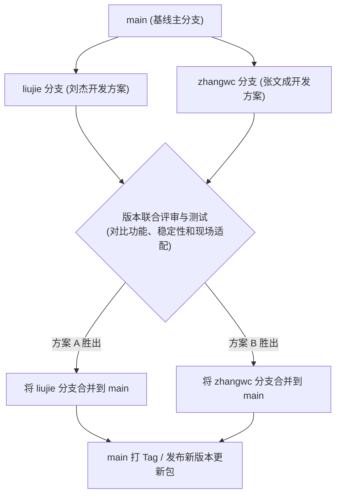

# 摸鱼小工具项目 · 协作开发与分支管理规范

本项目已托管至 GitHub 仓库：[Thresh0826/touch_fish](https://github.com/Thresh0826/touch_fish)。

为了方便多人协作开发、避免代码互相覆盖，特制定本分支协作指引。请所有参与开发的同学严格遵守。

---

## 一、分支规划与职责

| 分支名 | 说明与职责 | 当前状态 |
| :--- | :--- | :--- |
| **`main`** | **主分支（基线分支）**<br>保持稳定可发布状态。**严禁直接在此分支提交日常代码**，仅用于最终版本确定后的合并。 | 稳定基线版本 |
| **`liujie`** | **刘杰专属开发分支**<br>当前已同步包含了针对「v3 截图校验报窗口已变化」的排查报告问题修复代码。 | 已就绪，与基线同步 |
| **`zhangwc`** | **张文成专属开发分支**<br>用于张文成后续的代码开发、功能调整或独立方案实现。 | 已创建就绪，待提交 |

---

## 二、给合作开发者（张文成）的操作指引

请在开展后续开发工作时，按照以下步骤操作：

### 1. 克隆仓库与拉取分支
在本地电脑打开终端或命令行，执行：
```bash
# 1. 克隆项目到本地
git clone https://github.com/Thresh0826/touch_fish.git
cd touch_fish

# 2. 拉取所有远程分支
git fetch origin

# 3. 切换到你的专属分支 zhangwc
git checkout -b zhangwc origin/zhangwc
# （若本地已有该分支，直接切换即可：git checkout zhangwc）
```

### 2. 日常开发与提交
在 `zhangwc` 分支上进行本地代码编写与调试：
```bash
# 查看改动状态
git status

# 暂存与提交改动
git add .
git commit -m "feat/fix: 简要描述本次改动内容"

# 推送到远程 zhangwc 分支
git push origin zhangwc
```
> **注意**：请务必确保推送到 `origin zhangwc`，切勿推送到 `main` 或 `liujie` 分支。

---

## 三、版本评审与合并流程

当双方各自完成一个阶段的开发或问题修复后，按以下流程进行版本合并：



### 详细步骤：
1. **对照评审**：
   - 双方将各自的代码推送到对应分支后，在测试机或现场环境进行实际对比测试（验证截图定位、查询复制、异常处理等）。
2. **决定版本归属**：
   - 团队共同评审确定采用谁的方案（或者协商将两者优秀部分整合到其中一个分支）。
3. **合并入 `main`**：
   - 经过确认后，由项目负责人通过 GitHub 发起 Pull Request (PR) 或通过 Git 命令将最终选定的分支合并入 `main`：
   ```bash
   # 示例：确认采用某个分支并合入 main
   git checkout main
   git pull origin main
   git merge <被选中的分支名>
   git push origin main
   ```
4. **同步更新**：
   - `main` 分支更新后，另一方可选择将 `main` 最新的代码变动拉取回自己的分支保持同步。
